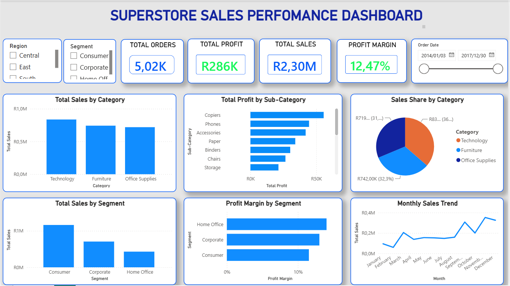

# Superstore Sales Performance Dashboard

**An End-to-End Retail Analytics Project Using Microsoft Excel and Power BI**

## 1. Project Overview

The Superstore Sales Performance Dashboard is a business intelligence project designed to analyse retail sales, profitability, product categories, customer segments, and monthly sales trends.

The project began in Microsoft Excel, where the source data was inspected, numeric values were corrected, and PivotTables were created to summarise business performance. The prepared dataset was then imported into Power BI, where DAX measures and interactive visualisations were developed.

The objective was to transform raw transaction data into meaningful business insights that can support data-driven decision-making.

## 2. Dashboard Preview



**Dashboard Screenshot:** [Click here to view the dashboard image](screenshots/superstore_dashboard.png)


## 3. Project Objectives

- Prepare and validate retail sales data for analysis.
- Correct numeric values affected by decimal-separator differences.
- Use Excel PivotTables to summarise sales, profit, and customer performance.
- Identify profitable and loss-making product sub-categories.
- Compare sales and profitability across customer segments.
- Create DAX measures for key performance indicators.
- Develop an interactive Power BI dashboard.
- Translate analytical findings into actionable business recommendations.

## 4. Tools and Technologies

| Tool | Purpose |
|---|---|
| Microsoft Excel | Data preparation, numeric conversion, PivotTables, and preliminary analysis |
| Microsoft Power BI Desktop | Data modelling, DAX calculations, and interactive visualisation |
| DAX | Business measures and performance calculations |
| GitHub | Version control and portfolio presentation |

## 5. Dataset Description

The project uses the Sample Superstore retail dataset, containing **9,994 transaction rows**.

The dataset includes information about orders, customers, products, locations, sales, discounts, quantities, and profit.

### Key Dataset Columns

- `Order ID`
- `Order Date`
- `Ship Date`
- `Ship Mode`
- `Customer ID`
- `Segment`
- `Region`
- `Category`
- `Sub-Category`
- `Sales`
- `Quantity`
- `Discount`
- `Profit`

**Currency note:** The reported financial figures retain the dataset's original currency and should not be interpreted as South African rand.

## 6. Excel Data Preparation and Analysis

Microsoft Excel was used to prepare the dataset and conduct initial business analysis before the data was imported into Power BI.

### 6.1 Inspecting the Source Data

The source dataset was opened in Excel and inspected to understand its structure and identify the fields required for analysis.

The worksheet was named `Sales`, and the dataset was converted into an Excel Table named `tblSales`.

Using an Excel Table made the data easier to reference and manage during cleaning, calculations, and analysis.

### 6.2 Correcting Decimal-Separator Differences

The source data used decimal points in numeric values, while the local Excel regional settings expected decimal commas.

This caused some numeric values, particularly financial fields, to be interpreted as text rather than numbers. Text-formatted numbers can prevent Excel from calculating totals and averages correctly.

The `NUMBERVALUE` function was used to convert the values explicitly.

For example, if the original value was in cell `P2`, the formula used was:

```excel
=NUMBERVALUE(P2;".";",")
```

This formula tells Excel to interpret:

- `"."` as the decimal separator.
- `","` as the thousands or grouping separator.

The semicolons separate the function arguments according to the local Excel configuration.

The converted values could then be used as numeric data in calculations and PivotTables.

### 6.3 Validating Numeric Columns

After converting the values, Excel's `COUNT` function was used to validate the numeric fields.

The following columns each returned **9,994 numeric values**:

- `Sales`
- `Profit`
- `Discount`
- `Quantity`

These counts matched the 9,994 transaction rows in the dataset.

This confirmed that Excel recognised the values in these columns as numeric. The resulting summaries were also reviewed to help verify the data's consistency.

### 6.4 Creating and Using PivotTables

After preparing the numeric fields, PivotTables were created to summarise the transaction-level data.

PivotTables made it possible to analyse thousands of records efficiently without manually calculating each category or customer segment.

The analysis included:

- **Sales by Category:** Compared Furniture, Office Supplies, and Technology.
- **Profit by Sub-Category:** Identified the strongest profit contributors and loss-making products.
- **Sales and Profit by Customer Segment:** Compared Consumer, Corporate, and Home Office customers.
- **Quantity Analysis:** Compared sales volume with revenue and profitability.
- **Summary Tables:** Supported comparisons and validation of overall totals.

The PivotTables helped demonstrate that high sales do not necessarily translate into high profitability.

### 6.5 PivotCharts and Visual Exploration

Charts were used to communicate the findings from the PivotTables.

The Excel analysis helped identify the main business questions addressed in the Power BI dashboard:

- Which product categories generate the highest sales?
- Which sub-categories generate the highest profit?
- Which products record losses?
- Which customer segments contribute the most revenue?
- How do sales and profitability differ across business segments?

Where applicable, interactive filtering tools such as slicers helped explore selected portions of the data.

## 7. Power BI Dashboard Development

The prepared Excel table, `tblSales`, was imported into Power BI Desktop.

The dashboard combines key performance indicators with visual comparisons of categories, sub-categories, customer segments, and monthly sales trends.

### 7.1 DAX Measures

Four core DAX measures were created.

#### Total Sales

```dax
Total Sales = SUM(tblSales[Sales])
```

Calculates the total sales value within the current filter context.

#### Total Profit

```dax
Total Profit = SUM(tblSales[Profit])
```

Calculates the total profit within the current filter context.

#### Total Orders

```dax
Total Orders = DISTINCTCOUNT(tblSales[Order ID])
```

Counts distinct order IDs rather than transaction rows.

#### Profit Margin

```dax
Profit Margin =
DIVIDE([Total Profit], [Total Sales], 0)
```

Calculates profit as a proportion of sales. The `DIVIDE` function returns zero if the denominator is zero.

The measures were formatted appropriately in Power BI, with sales and profit as currency, orders as a whole number, and profit margin as a percentage.

### 7.2 Dashboard Visualisations

The completed Power BI dashboard contains:

1. **KPI Cards:** Total Sales, Total Profit, Total Orders, and Profit Margin.
2. **Sales by Category:** Compares revenue across the three main categories.
3. **Profit by Sub-Category:** Ranks products according to profitability.
4. **Sales by Customer Segment:** Compares Consumer, Corporate, and Home Office customers.
5. **Profit Margin by Customer Segment:** Highlights differences in relative profitability.
6. **Sales Share by Category:** A pie chart showing each category's share of sales.
7. **Monthly Sales Trend:** A line chart showing changes in sales over time.
8. **Interactive Slicers:** Filters for Region, Segment, and Order Date.

The slicers allow users to explore the dashboard dynamically and compare performance across selected groups and time periods.

## 8. Key Business Findings

### 8.1 Overall Performance

| Metric | Result |
|---|---:|
| Total Sales | 2,297,200.86 |
| Total Profit | 286,397.02 |
| Transaction Rows | 9,994 |
| Average Discount | 15.59% |
| Profit Margin | 12.47% |

### 8.2 Performance by Product Category

| Category | Sales | Profit | Profit Margin |
|---|---:|---:|---:|
| Technology | 836,154.03 | 145,454.95 | 17.40% |
| Office Supplies | 719,047.03 | 122,490.80 | 17.04% |
| Furniture | 741,999.80 | 18,451.27 | 2.49% |

**Finding:** Technology generated the highest sales and profit. Furniture generated substantial sales but had a considerably lower profit margin.

### 8.3 Performance by Customer Segment

| Segment | Sales | Profit | Profit Margin |
|---|---:|---:|---:|
| Consumer | 1,161,401.34 | 134,119.21 | 11.55% |
| Corporate | 706,146.37 | 91,979.13 | 13.03% |
| Home Office | 429,653.15 | 60,298.68 | 14.03% |

**Finding:** Consumer customers contributed the highest sales and total profit. Home Office customers achieved the highest profit margin relative to sales.

### 8.4 Sub-Category Profitability

- **Copiers:** Generated profit of 55,617.82, the highest among the listed sub-categories.
- **Phones:** Generated sales of 330,007.05 and profit of 44,515.73.
- **Tables:** Recorded a loss of 17,725.48.
- **Bookcases:** Recorded a loss of 3,472.56.
- **Supplies:** Recorded a loss of 1,189.10.

**Finding:** Sales revenue alone is not enough to evaluate product performance. Some products generate significant revenue while delivering limited profit or recording losses.

## 9. Business Recommendations

1. **Investigate Furniture profitability.** Review pricing, discounting, product costs, shipping expenses, and product mix.
2. **Review loss-making sub-categories.** Investigate Tables, Bookcases, and Supplies to identify possible cost or pricing issues.
3. **Study Technology's performance.** Examine which products and customer groups contribute to its strong results.
4. **Explore high-margin customer segments.** Investigate the purchasing patterns of Home Office customers and whether their margins are sustainable.
5. **Monitor monthly sales trends.** Use historical patterns to support planning and identify unusual changes.
6. **Evaluate discount effectiveness.** Compare any increase in sales associated with discounts against the effect on profitability.

These recommendations identify areas for further investigation. The analysis does not independently establish the causes of the observed results.

## 10. How to Use the Dashboard

1. Open the Power BI `.pbix` report in Power BI Desktop.
2. Review the KPI cards for an overview of performance.
3. Explore sales by category and profit by sub-category.
4. Compare the customer segment visuals.
5. Use the Region, Segment, and Order Date slicers to filter the report.
6. Examine how the selected filters affect the displayed metrics and charts.

## 11. Suggested Repository Structure

```text
Superstore-Sales-Performance-Dashboard/
├── README.md
├── data/
│   └── superstore_cleaned.csv
├── screenshots/
│   └── superstore_dashboard.png
├── reports/
│   └── business_report.pdf
└── powerbi/
    └── superstore_dashboard.pbix
```


## 12. Project Limitations

- The analysis describes the available historical data and does not prove why a particular result occurred.
- The dataset may not contain every operating cost required to explain product-level profitability.
- The monthly sales chart presents historical performance; it is not a forecasting model.
- Business decisions should consider additional context and validation before the findings are acted upon.

## 13. Author

**Kefasi Vurumu**

Aspiring Data Analyst | Business Intelligence | Data Analytics
# FURNITURE-STORE-SALES-PERFOMANCE-ANALYISIS

